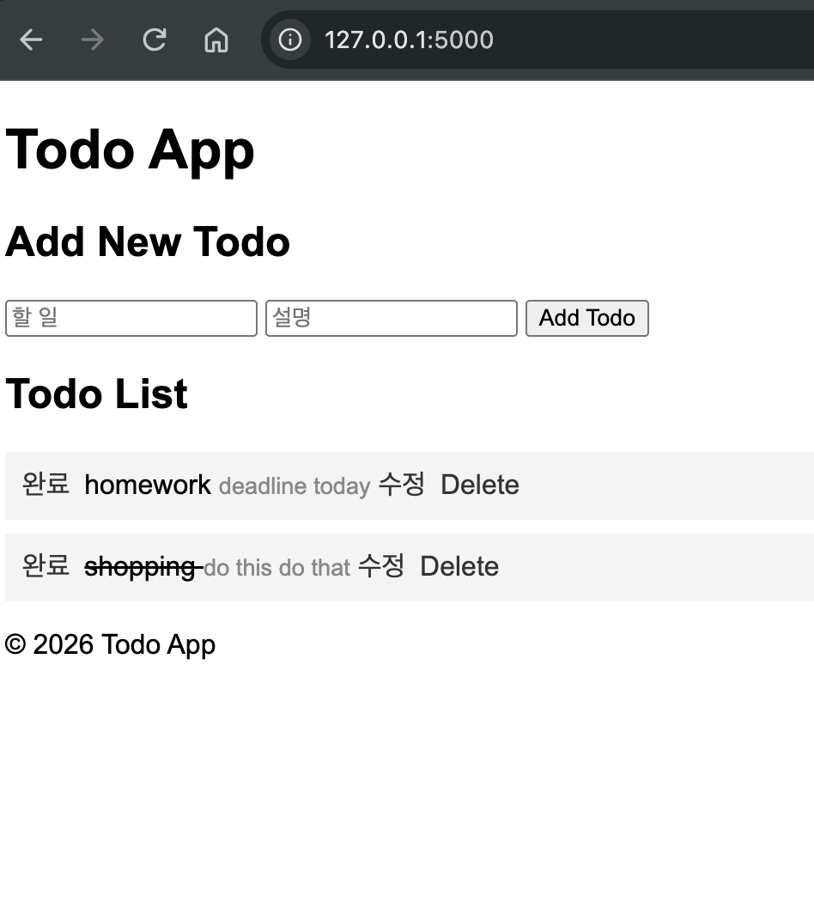
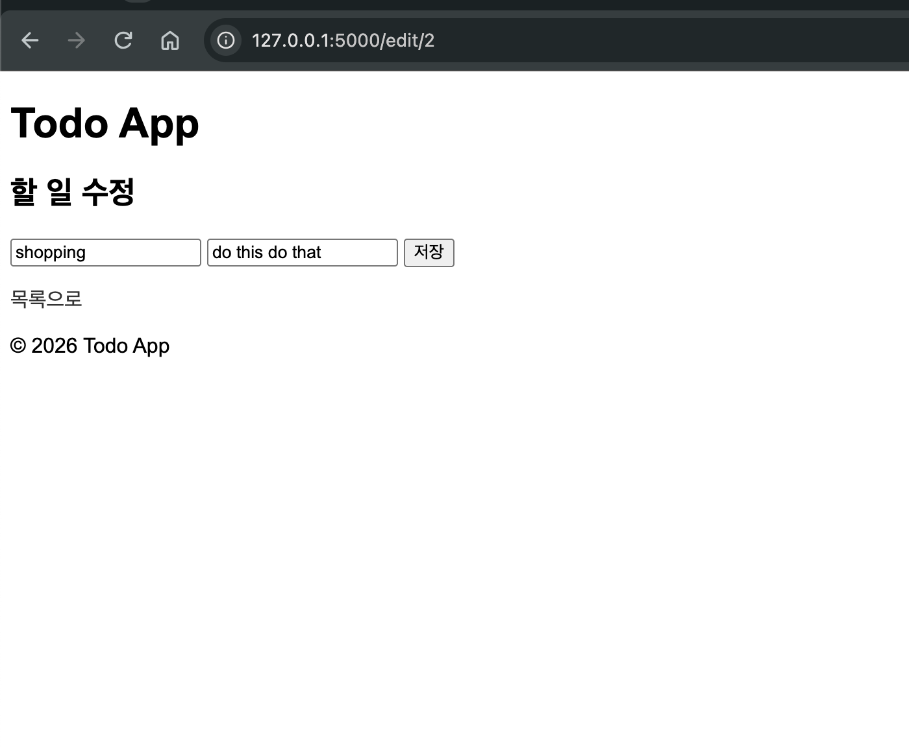
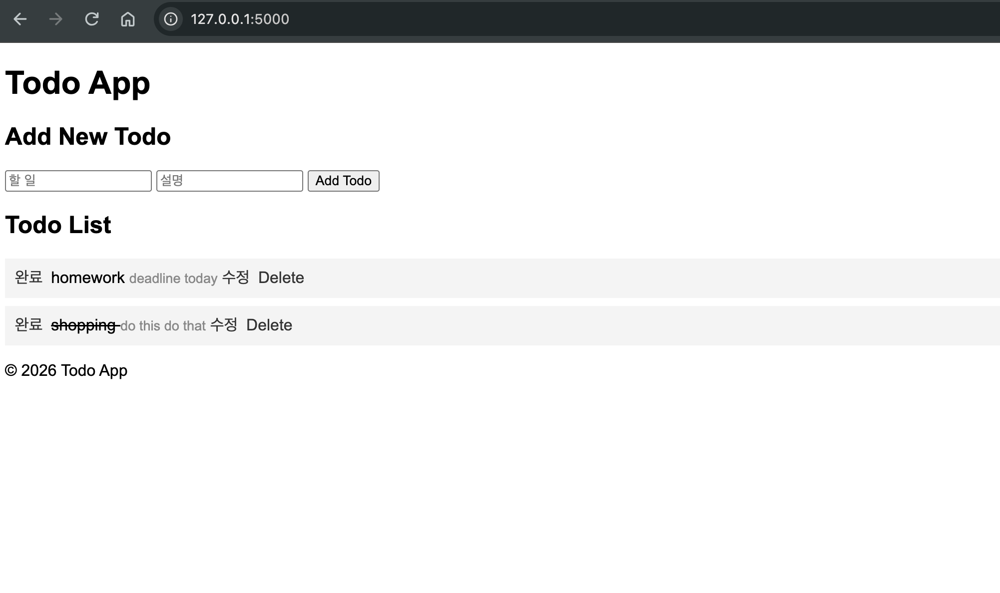

# HW3 – Todo App with Edit Functionality

## Student Information

- Name: Utkirbek
- Student ID: 23012866

## Overview

This project is a Todo application built with Flask and Flask-SQLAlchemy. It uses an SQLite database to store Todo items so that the data remains available after the server is restarted.

## Features

- **Add Todo:** Add a new Todo item with a title and description.
- **View Todos:** Display Todo items stored in the database.
- **Toggle Completion:** Mark a Todo item as completed or incomplete.
- **Edit Todo:** Edit the title and description of an existing Todo item.
- **Delete Todo:** Delete a Todo item from the list.
- **Persistent Storage:** Todo items remain saved after restarting the server.

## Technologies Used

- Python
- Flask
- Flask-SQLAlchemy
- SQLite
- HTML and CSS

## How to Run the Application

1. Open a terminal in the `HW3` directory.
2. Activate your virtual environment.
3. Install the required dependencies if necessary:

   ```bash
   pip install -r ../requirements.txt
   ```

4. Start the Flask application:

   ```bash
   flask --debug run
   ```

5. Open the following address in your browser:

   `http://127.0.0.1:5000`

The SQLite database is created automatically when the application starts.

## Testing

The following functions were tested:

1. Added a Todo item with a title and description.
2. Verified that Todo items appeared on the list.
3. Toggled a Todo item between completed and incomplete.
4. Edited an existing Todo item's title and description.
5. Deleted a Todo item.
6. Restarted the Flask server and verified that saved Todo items remained in the database.

## Screenshots

### 1. Todo List Screen

This screenshot shows the Todo list, including the Todo titles, descriptions, and available actions.




### 2. Edit Todo Screen

This screenshot shows the edit page, where an existing Todo item's title and description can be modified.




### 3. Data Persistence After Restarting the Server

This screenshot shows that the Todo items remain in the list after stopping and restarting the Flask server.




## Database

The application uses SQLite and Flask-SQLAlchemy to store Todo items. The database is generated automatically when the application runs. The database file is excluded from the GitHub repository because it contains local application data.

