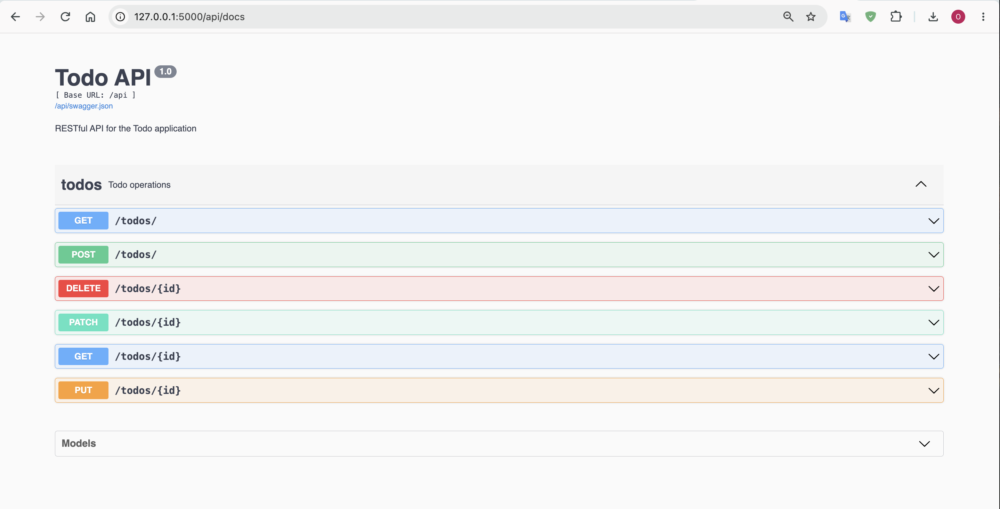
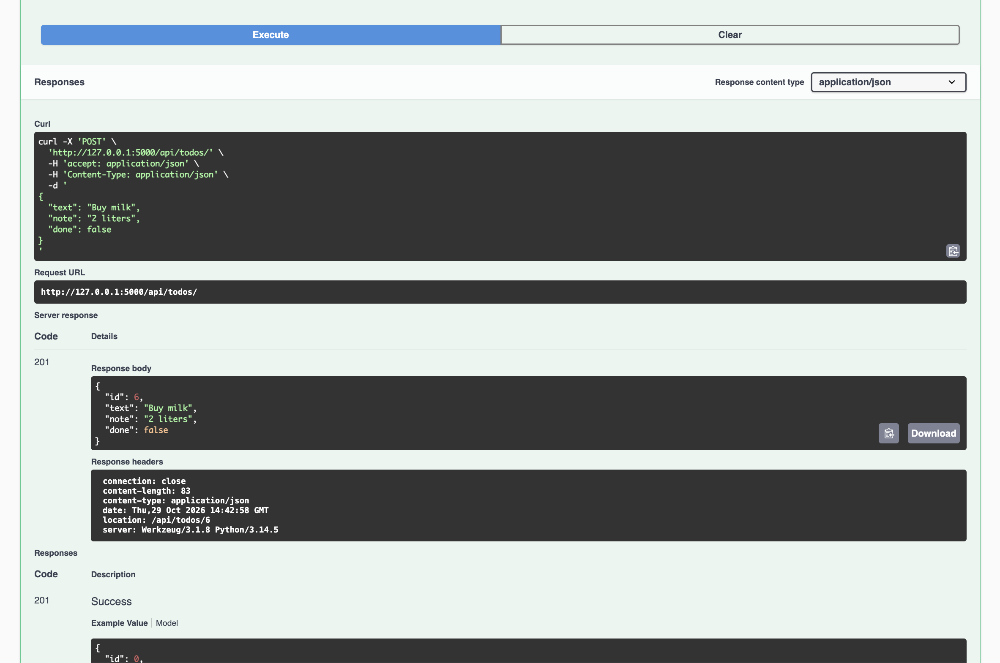
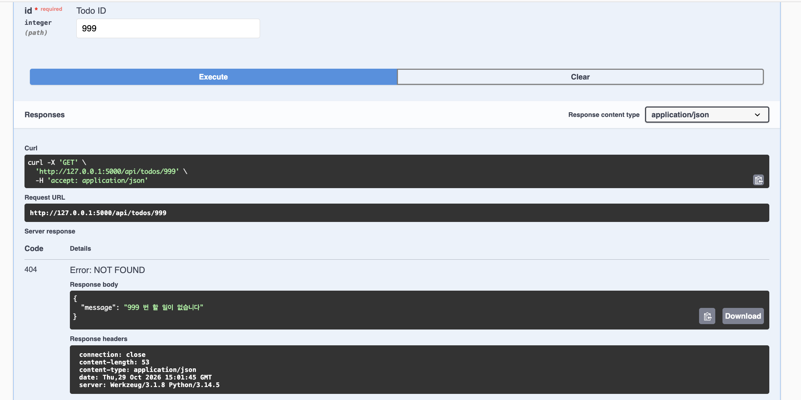

# HW4: Todo App REST API

## Project Description

This project is a Todo application developed using Flask,
Flask-SQLAlchemy, and Flask-RESTX.

## Features

- Create new todos
- View all todos
- View a single todo
- Edit and delete todos
- Mark todos as completed
- Add notes to todos
- Filter todos by completion status
- REST API with Swagger UI

## How to Run

1. Install the required packages:

   pip install -r requirements.txt

2. Start the Flask server:

   flask --debug run

3. Open the application:

   http://127.0.0.1:5000/

4. Open Swagger UI:

   http://127.0.0.1:5000/api/docs

## API Testing

Run the automated tests:

    python -m unittest -v

Result: 9 tests passed successfully.

## Screenshots

### 1. Swagger API Documentation

### 2. Create Todo - 201 Created

### 3. Todo Not Found - 404

